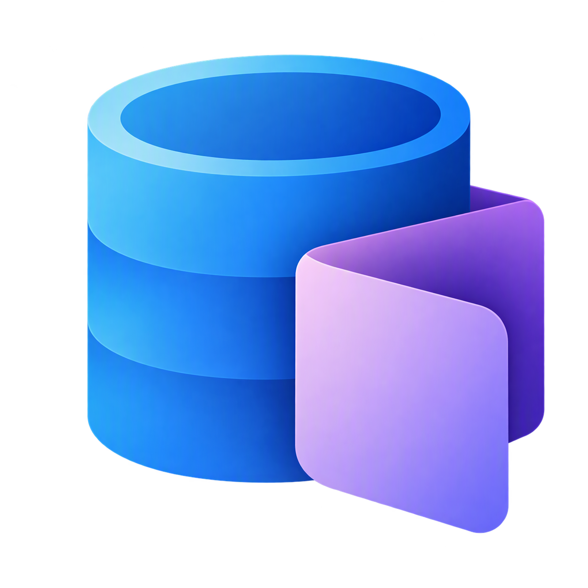

# SQL Apps

**Your idea. Your assistant. Your app.**

Build SQL-backed web applications with the coding assistant you already use. Describe your idea, shape the important rules, and build a working application you own.

SQL Apps is a lightweight plugin that guides your assistant—not a service that hosts your app. No SQL Apps account or subscription is required, and your finished app runs without the plugin.

## What you get

- **A complete app, not a mockup.** Build useful screens and workflows backed by real SQL data and business rules.
- **A path from your computer to the cloud.** Start locally, then use the included Azure deployment guides when you're ready. Cloud deployment still needs live testing.
- **An app you own.** Keep the code, database changes, tests, settings, and run instructions.
- **Less repeated setup.** A [copyable application starter](./skills/sql-apps/templates/starter/README.md) brings together the screens, sign-in, database access, and checks for a working first version.

## Get started

### 1. Install SQL Apps

| Assistant | Setup |
| --- | --- |
| GitHub Copilot / VS Code | [Plugin marketplace or local setup](./docs/installation.md#github-copilot-and-vs-code) |
| Claude Code | [Plugin marketplace](./docs/installation.md#claude-code) |
| OpenAI Codex | [Codex marketplace](./docs/installation.md#openai-codex) |
| Gemini CLI | [Gemini extension](./docs/installation.md#gemini-cli) |
| Cursor | [Team marketplace](./docs/installation.md#cursor) |

The marketplace install coordinate is **`sql-apps@sql-apps-skills`**. See the [installation guide](./docs/installation.md) for host setup and required companion tools.

Your assistant checks which tools are already installed and helps with anything missing. You choose whether to work locally or use Azure; it won't create or change cloud resources just because you have a subscription. Detailed setup questions wait until needed.

### 2. Build your first workflow

Open the directory where you want the application and ask:

> Use SQL Apps to build an equipment reservation app. Staff manage equipment; members reserve it; overlapping reservations must be rejected. Ask about important missing rules, then build and verify one complete workflow locally.

The assistant helps shape the requirements, then builds and tests the app. Try saving a reservation, reloading it from SQL, and rejecting a conflicting reservation.

## Learn more

The starter uses TypeScript, React, and Azure SQL Database. Data API builder (DAB) is the default way for the app to reach SQL. Static Web Apps Free instead uses Azure Functions to connect directly to SQL, without DAB. Container Apps and App Service F1 use DAB. See the hosting guide below for the trade-offs; the cloud deployment paths still need live testing.

| Topic | Guide |
| --- | --- |
| Missing plugins and local setup options | [Quick setup](./docs/installation.md#quick-setup-when-a-capability-is-missing) |
| Supported architecture and project rules | [Project constitution](./skills/sql-apps/references/constitution.md) |
| Cloud readiness, deployment approvals, and validation | [Deployment guidance](./skills/sql-apps/references/deployment.md) |
| Choosing Container Apps, App Service F1, or Static Web Apps Free | [Hosting options](./skills/sql-apps/templates/starter/hosting.md) |
| Concrete Container Apps and SQL deployment steps | [Bicep/container recipe](./skills/sql-apps/templates/starter/deployment.md) |
| Resource naming and attribution tags | [Deployment attribution](./skills/sql-apps/references/deployment-attribution.md) |
| UI conventions | [App design](./skills/sql-apps/references/app-design.md) |
| Future Fabric migration boundaries | [Rayfin alignment](./skills/sql-apps/references/rayfin-alignment.md) |
| Plugin packaging, validation, and release status | [Release and verification guide](./docs/reference/releasing.md) |
| Support limits | [Support](./SUPPORT.md) |

## Preview and important limits

SQL Apps is in **preview**, currently at version **0.3.0**. Installation packages are available for five assistant families, but they have not all been tested end to end. The starter passes build and local tests; real sign-in and Azure deployment still need verification. Earlier hands-on VS Code testing used version 0.2.1, not this version. See the [verification status](./docs/reference/releasing.md#verification-status), [starter test results](./docs/reference/releasing.md#starter-baseline-010), and [earlier hands-on results](./docs/reference/releasing.md#recorded-local-candidate-proof) for exactly what was tested.

> **Local database setup:** The Azure SQL Database container for local development is in **Private Preview** and is not included with SQL Apps. [Sign up for access](https://aka.ms/sqldbcontainerpreview-signup), then follow the [official getting-started guide](https://microsoft.github.io/azure-sql-database-container/getting-started.html). You can build screens and plan the database while waiting, but saving and loading real data needs a working database and the selected API.

Supported databases are Azure SQL Database, either locally in the preview container or in Azure—not on-premises SQL Server. If local access is unavailable, the assistant won't switch to Azure without your approval.

Review generated code, access controls, migrations, and recovery before using real or regulated data. Azure deployment requires its own review and approval; free allowances do not guarantee zero cost, and budget alerts do not stop spending. You are responsible for charges. Tools, AI providers, local database containers, and Azure services have separate availability, licensing, and pricing terms. No service-level agreement or Microsoft support commitment is provided; Azure support follows your Azure agreement. See [Support](./SUPPORT.md).

Never commit credentials or private user data. Do not report vulnerabilities in public issues; follow [Security](./SECURITY.md) for private reporting.

This project follows the [Microsoft Open Source Code of Conduct](./CODE_OF_CONDUCT.md). Use of Microsoft and third-party trademarks or logos must follow their respective policies.

## License

Licensed under the [MIT License](./LICENSE). SQL Apps is provided "as is," without warranty, subject to the license terms.
