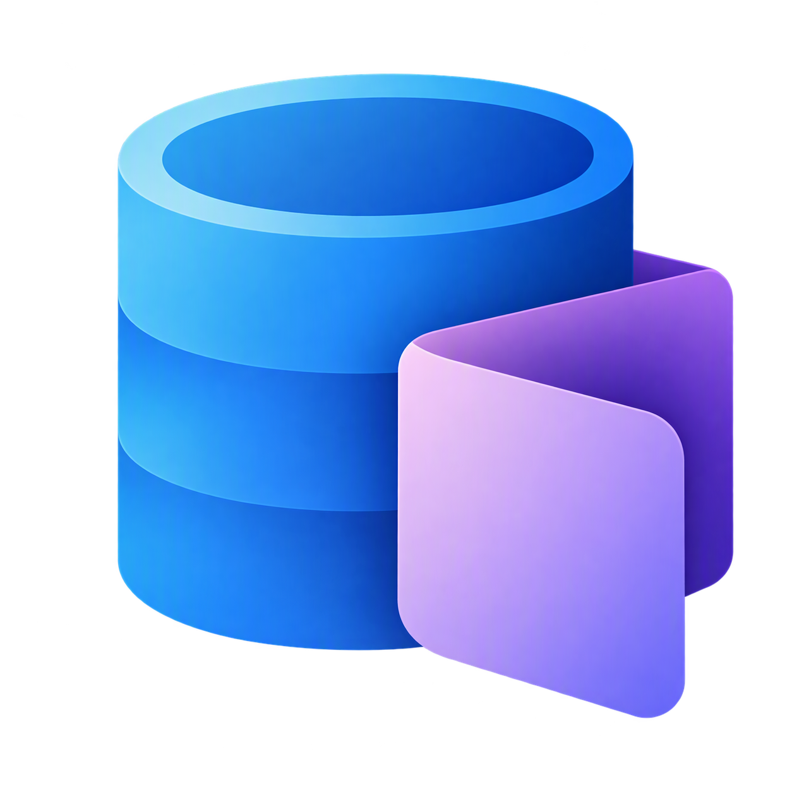

# SQL Apps

**Your idea. Your assistant. Your app.**

Build SQL-backed web applications with the coding assistant you already use.
Describe a useful workflow, resolve its important rules, then build and verify
screens backed by real data. Keep the source, migrations, tests and run instructions.

SQL Apps is a lightweight guidance plugin, not a hosting service or application
runtime. No SQL Apps account or subscription is required; your app runs without it.
Start locally and consider Azure only when requested.

## Get started

### 1. Install SQL Apps

| Assistant | Setup |
| --- | --- |
| GitHub Copilot / VS Code | [Marketplace or local setup](./docs/installation.md#github-copilot-and-vs-code) |
| Claude Code | [Marketplace](./docs/installation.md#claude-code) |
| OpenAI Codex | [Codex marketplace](./docs/installation.md#openai-codex) |
| Gemini CLI | [Gemini extension](./docs/installation.md#gemini-cli) |
| Cursor | [Team marketplace](./docs/installation.md#cursor) |

The marketplace coordinate is **`sql-apps@sql-apps-skills`**. Follow your host's
installation guide, check version/skill discovery, then start a fresh session.
The assistant discovers required companion tools and helps with missing setup;
installation does not grant database access or authorize cloud changes.

### 2. Build your first workflow

Open the application directory and ask:

> Use SQL Apps to build an equipment reservation app. Staff manage equipment;
> members reserve it; overlapping reservations must be rejected. Ask about
> important missing rules, then build and verify one complete workflow locally.

Try saving a reservation, reloading it from SQL and rejecting a conflict.
The [starter's local guide](./skills/sql-apps/templates/starter/README.md) covers
explicit Build → Start, Test, acceptance and owned Stop. The default is
TypeScript/React, DAB and Azure SQL; explicit Functions uses the same public
start commands without DAB. Neither profile compiles secretly during Start/Test.

## Guides

| Need | Guide |
| --- | --- |
| Missing tools/database access | [Prerequisites](./skills/sql-apps/references/prerequisites.md) |
| Stack and durable project rules | [Constitution](./skills/sql-apps/references/constitution.md) |
| UI conventions | [App design](./skills/sql-apps/references/app-design.md) |
| Container Apps, F1 or Static Web Apps | [Profile differences](./skills/sql-apps/templates/starter/hosting.md) |
| Cloud review and operator steps | [Deployment policy](./skills/sql-apps/references/deployment.md) / [app-owned runbook](./skills/sql-apps/templates/starter/deployment.md) |
| Version tags and naming | [Attribution](./skills/sql-apps/references/deployment-attribution.md) |
| Package/release history and measured checks | [Release and verification](./docs/reference/releasing.md) |

## Preview and important limits

**Preview: 0.3.0 release candidate, not proof of publication or certification.**
Host loading, real-provider sign-in and complete cloud acceptance have remaining
gates; historical results and exact boundaries belong in the release guide.

The local Azure SQL Database container is **Private Preview**, separately licensed
and not bundled. [Sign up for access](https://aka.ms/sqldbcontainerpreview-signup)
and follow the [official quickstart](https://microsoft.github.io/azure-sql-database-container/getting-started.html).
Only that engine or Azure SQL Database cloud is supported, not on-premises SQL
Server. Missing SQL/selected API leaves persistence unverified; no automatic cloud switch.

Review generated code, authorization, migrations and recovery before real or
regulated data. Cloud writes need separate resource/access/spend approval.
Allowances do not guarantee zero cost; budget alerts do not stop charges.
You are responsible for costs. Tools, providers and Azure services have separate
availability, licensing and pricing terms.

No SLA or Microsoft support commitment is provided; Azure support follows your
agreement. See [Support](./SUPPORT.md). Never commit credentials/private data;
report vulnerabilities privately through [Security](./SECURITY.md).
Follow the [Code of Conduct](./CODE_OF_CONDUCT.md) and applicable trademark/logo policies.

## License

[MIT License](./LICENSE), provided “as is” without warranty under its terms.
